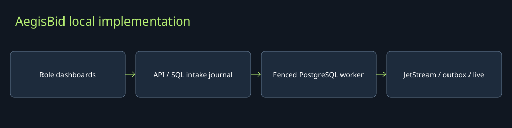
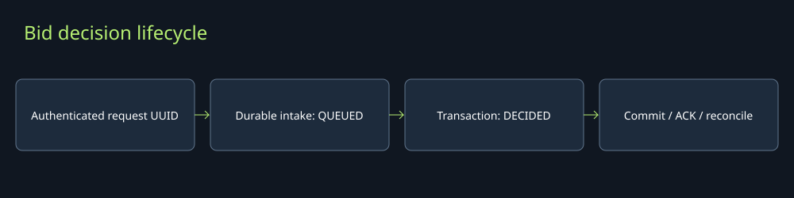
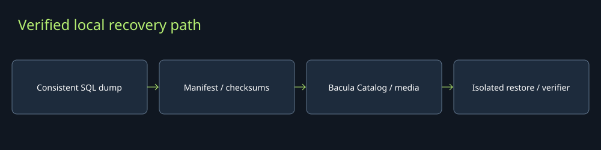

# AEGISBID OMEGA
## Complete, detailed build guide

**Project:** Self-healing flash-auction system with 50,000-connection design target, immutable decision audit, admin analytics, chaos testing, and Bacula-powered disaster recovery.

**Read this first.** This is an **implementation blueprint, not evidence that the complete system already exists**. Commands are practical starting points but need version-specific adjustments and testing. Do not claim 50,000 connections or any RPO/RTO target has been achieved until a test proves it. Never perform destructive demonstrations against production data.



## Quick navigation

1. Scope, priorities and success conditions
2. Workstation, dependencies and repository structure
3. Business rules and contracts
4. Database schema and consistency model
5. Durable bid-intake and worker design
6. WebSockets and four dashboards
7. Admin monitoring, security and fault injection
8. Bacula backup infrastructure
9. Recovery and independent verification
10. Load tests, deployment, video, and submission checklists

# 1. Plan your build in three levels

| Level | What must be working | Why |
|---|---|---|
| **P0: Demonstrable core** | Authenticated user bidding, one correct auction worker, PostgreSQL decision ledger, live status, user + admin dashboards, backup and restore, test results | Meets problem and professor's explicit dashboard/disaster requirements |
| **P1: Distinctive distributed demo** | JetStream 3-node cluster, replay-safe worker, worker failover, failure injection, event replay, recovery verifier | Makes the engineering work visibly advanced |
| **P2: Production extension** | Multi-zone load balancers, synchronous standby and fenced failover, stronger key management, multi-host 50k tests, offsite immutability, independent auditor portal | Architecture proposal, not a two-day implementation promise |

### Concrete acceptance targets

- One bid request has a stable `request_id`. Retrying it never creates a second business decision.
- Final winners are at most `stock` distinct eligible bidders; all amounts are stored as integer cents.
- A bid is called **accepted** only after the authoritative PostgreSQL decision transaction commits. An intake acknowledgment is merely **queued**.
- A crashed worker can restart, replay pending commands, and avoid duplicate effects.
- User and admin dashboards load from actual APIs; admin analytics show measured numbers, not mock cards.
- A Bacula backup job completes; you restore into an **isolated** database and independently compare records.
- A burst test reports throughput, p50/p95/p99 decision latency, connection count, error rate, and outcome validity.

**Definition of the 50,000 goal:** 50,000 open WebSocket connections is *not* 50,000 bids submitted in the same millisecond. Report these two capabilities separately.

# 2. Prerequisites and initial workspace

## 2.1 Choose development environment

Recommended: **Ubuntu under WSL2 or a Linux VM** for backend services and Bacula, Docker Engine / Docker Desktop for containers, and a browser for the dashboards. A full multi-node benchmark must eventually use separate load-generator hosts. On a 16 GB laptop, start with an intentionally smaller workload and record actual resource consumption.

Install or verify: Git, Docker + Docker Compose v2, Python 3.12+, Node.js LTS, Go 1.23+ (or a tested supported release), PostgreSQL client, `psql`, NATS CLI, Grafana/Prometheus images, and a Bacula distribution compatible with your operating system.

```bash
# Run inside Ubuntu / WSL2. These commands inspect availability.
git --version
docker version
docker compose version
python3 --version
node --version
go version
psql --version
```

If Bacula is not installed on your Linux backup host:

```bash
sudo apt update
apt-cache search '^bacula'
# Choose the supported director, storage, file-daemon and catalog
# packages for this distribution. Package names vary by release.
```

Do not assume that a Bacula container alone creates an offsite backup. **Separate hosts, independent storage, and independently recoverable Catalog/configuration are part of the design.**

## 2.2 Repository layout

```text
aegisbid/
  apps/
    bidder-web/              # customer auction dashboard
    admin-web/               # operations + backup status + chaos panel
    seller-web/              # seller auction management
    auditor-web/             # receipt and reconstruction verification
  services/
    api/                     # auth, admin, snapshots, HTTP bid admission
    gateway/                 # WebSocket connections and fanout
    auction-worker/          # single-writer decision loop per auction
    outbox-relay/            # committed decisions -> live notifications
    verifier/                # offline replay and invariant checks
    chaos-controller/        # strictly allowlisted test fault injection
    backup-exporter/         # creates safe PostgreSQL/NATS export files
  packages/
    contracts/               # JSON schemas and typed shared messages
    observability/           # metrics / trace conventions
  infra/
    compose.yaml
    postgres/
    nats/
    prometheus/
    grafana/
    bacula/
  scripts/
    seed_demo.py
    run_load.sh
    backup_export.sh
    restore_sandbox.sh
    verify_recovery.py
  tests/
    unit/
    integration/
    chaos/
    load/
  docs/
    architecture.md
    runbook.md
    measurements.md
    evidence/
  .env.example
  README.md
```

**Start from your existing FastAPI + Redis FlashBid implementation:** preserve its valid bid logic and tests while moving the final accepted-decision authority to the new PostgreSQL ledger. Do not attempt a wholesale rewrite until a reliable core demonstration works.

## 2.3 Decide one truthful MVP stack

| Role | Local practical choice | Advanced target |
|---|---|---|
| Bid API | FastAPI / Python | Go gateway plus separate bid admission |
| Realtime | FastAPI WebSockets or Go | Multiple Go WebSocket gateways |
| Command log | One NATS JetStream server initially | Three NATS servers with replicated streams |
| Correct decisions | One PostgreSQL transaction service | Active/standby auction workers with fencing |
| Read projections | Redis (optional) | Redis cluster, fully rebuildable |
| Frontend | Next.js + Tailwind | Four role-specific views |
| Backup | Bacula on separate Linux VM with file backup | Offsite protected backup domain with restore exercises |

# 3. Define the auction rules before writing code

Use a **limited-stock, pay-your-own-bid** auction for the demo:

- Each auction has `auction_id`, `stock`, `min_price_cents`, `increment_cents`, `opens_at`, `closes_at`, `status`, `version`.
- A bidder may submit an increased replacement offer. The auction retains the bidder's current best offer and its history.
- The engine checks minimum price/increment rules and closed-auction rules. These checks happen **inside one authoritative decision transaction**, not only in the browser.
- At close, sort eligible unique bidders by amount descending; define a deterministic tie-breaker using recorded arrival order (or reject equal offers if rules demand strict increments). Return the first `stock` winners.
- Winning bids are promises/records in this prototype. Do **not** describe payment authorization, inventory fulfillment or tax compliance as implemented unless you actually build them.

### Documented policy for late commands

For an auditable design, distinguish **client click time**, **durable admission time** and **decision time**. The auction policy must define which time controls eligibility. For the prototype, assign a server-side `admitted_at` when an admission service records the command and validate it against `closes_at`; require synchronized infrastructure clocks and document the remaining skew risk. A stricter future implementation can use one authoritative per-auction sequencer and an ordered `CLOSE` event so command ordering is never inferred from client clocks. Never use timestamps supplied by browsers to decide winners.

### Bid lifecycle



A request can be **QUEUED**, then **ACCEPTED/REJECTED/CLOSED**, then **DELIVERED**. A disconnected client queries its old request ID; it does not blindly invent a fresh bid.

# 4. Design the PostgreSQL database

## 4.1 Core tables

Create migrations for these tables:

| Table | Essential fields | Mandatory constraints |
|---|---|---|
| `auctions` | `id`, `seller_id`, `stock`, `min_price_cents`, `increment_cents`, `opens_at`, `closes_at`, `status`, `version` | `stock > 0`, valid monetary and time values |
| `bid_requests` | `request_id`, `auction_id`, `bidder_id`, `amount_cents`, `admitted_at`, `intake_seq`, `state` | unique `(auction_id, bidder_id, request_id)` |
| `bid_decisions` | `decision_id`, `request_id`, `status`, `reason`, `effective_amount_cents`, `decision_seq`, `epoch` | unique `request_id` and unique per-auction decision sequence |
| `bidder_offers` | `auction_id`, `bidder_id`, `current_amount_cents`, `decision_seq` | unique `(auction_id, bidder_id)` |
| `auction_events` | `event_id`, `auction_id`, `event_seq`, `payload`, `prev_hash`, `event_hash` | unique `(auction_id, event_seq)` |
| `winners` | `auction_id`, `bidder_id`, `rank`, `final_amount_cents` | unique `(auction_id, bidder_id)` and rank |
| `worker_leases` | `auction_id`, `holder_id`, `epoch`, `lease_expires_at` | one leader record per auction |
| `outbox` | `id`, `auction_id`, `event_type`, `body`, `published_at` | persisted in same transaction as decision |
| `backup_jobs` | `job_id`, `started_at`, `status`, `artifact_path`, `checksum` | audit records for backup monitoring |
| `recovery_runs` | `run_id`, `backup_id`, `rpo_s`, `rto_s`, `verified`, `report_path` | each restoration independently logged |

Use numeric BIGINT cents (or another checked integral type), never floating-point currency values. Keep buyer identity and personally identifying information out of public WebSocket snapshots.

### Minimal SQL invariants

```sql
-- Illustrative migration fragment; add FK relationships and indexes.
CREATE TABLE bid_decisions (
  decision_id BIGSERIAL PRIMARY KEY,
  auction_id UUID NOT NULL,
  request_id UUID NOT NULL UNIQUE,
  bidder_id UUID NOT NULL,
  status TEXT NOT NULL CHECK (status IN ('ACCEPTED','REJECTED','CLOSED')),
  effective_amount_cents BIGINT,
  decision_seq BIGINT NOT NULL,
  leader_epoch BIGINT NOT NULL,
  committed_at TIMESTAMPTZ NOT NULL DEFAULT now(),
  UNIQUE (auction_id, decision_seq)
);

CREATE TABLE outbox (
  id BIGSERIAL PRIMARY KEY,
  auction_id UUID NOT NULL,
  event_type TEXT NOT NULL,
  payload JSONB NOT NULL,
  published_at TIMESTAMPTZ
);
```

## 4.2 One atomic business decision

The worker executes this sequence within **one PostgreSQL transaction**:

1. Lock the relevant `auctions` row (`SELECT ... FOR UPDATE`).
2. Lock/check the auction's worker lease and validate the current fencing `epoch`.
3. Look up `request_id`. If an outcome exists, reuse it and finish without applying the bid again.
4. Validate admission timestamp, auction state, amount and bidder eligibility.
5. Determine accepted/rejected decision, update affected offers/counters, and increment the per-auction decision sequence.
6. Insert bid decision, event/hash link and `outbox` row **before committing**.
7. Commit, then acknowledge the consumed NATS message. Do not acknowledge first.

Why it works: if the worker crashes after DB commit but before acknowledging NATS, the message may be delivered again; the unique request ID causes a harmless replay. This is **at-least-once delivery with exactly-once business effect under the stated constraints**, not magical exactly-once network transport.

**Throughput caution:** A single hot auction deliberately serializes decisions. That improves correctness but sets an upper limit on bids/second; measure it. Different auctions can run in parallel on separate partitions/workers.

# 5. Build the durable command pipeline

## Step 5.1: Start services

Begin `infra/compose.yaml` with service definitions for `postgres`, `redis`, `nats1`, `api`, `worker`, `gateway`, `prometheus` and `grafana`. Add `nats2` and `nats3` after the single-node path is correct. Put volumes on persistent named mounts. Never expose PostgreSQL, NATS administration or Bacula ports publicly. Do not store passwords in Git; use `.env` secrets only for local development.

```bash
docker compose -f infra/compose.yaml config
docker compose -f infra/compose.yaml up -d postgres nats1 redis
docker compose -f infra/compose.yaml ps
# Then run migrations, API, gateway and worker.
```

## Step 5.2: Create a JetStream stream

The command subject can follow `auction.<auction_uuid>.commands`. Create a file-backed stream with replicas set to `1` for the first local test and `3` only after the NATS cluster has three healthy members. Define a durable consumer per processing partition. Use explicit acknowledgments and configured redelivery limits; configure a dead-letter inspection path for poison messages.

A published command contains:

```json
{
  "schema_version": 1,
  "request_id": "uuid",
  "auction_id": "uuid",
  "bidder_id": "uuid-from-auth",
  "amount_cents": 12500,
  "admitted_at": "server-utc-timestamp",
  "origin_gateway": "gw-1"
}
```

NATS JetStream uses at-least-once semantics by default. A publish acknowledgment means the stream stored the command according to its configured durability; it does **not** mean the auction accepted the bid.

## Step 5.3: Add HTTP and WebSocket contracts

```text
POST /v1/auth/login                 login / demo identity
GET  /v1/auctions                  list visible auctions
GET  /v1/auctions/{id}             authoritative snapshot and version
POST /v1/auctions/{id}/bids        enqueue request, return 202 QUEUED
GET  /v1/bid-requests/{requestId}  retrieve final known decision
GET  /v1/auctions/{id}/winners     final allocation after close
WS   /v1/live/auctions/{id}        versioned live snapshots and decisions
POST /v1/admin/auctions            create auction (RBAC)
GET  /v1/admin/metrics             protected aggregated metrics
POST /v1/admin/chaos/scenarios    strictly local test mode only
GET  /v1/admin/backups            Bacula job and restore statuses
GET  /v1/audit/auctions/{id}       sanitized evidence package
```

HTTP response to enqueue should be unambiguous:

```json
{"request_id":"uuid","state":"QUEUED","message":"Not yet accepted"}
```

Decision notification example:

```json
{"type":"bid.decision","request_id":"uuid","auction_id":"uuid",
 "status":"ACCEPTED","version":18,"decision_seq":18,
 "server_time":"UTC-timestamp"}
```

Do not broadcast other bidders' tokens, raw identities, internal addresses or private receipts.

## Step 5.4: Reconnection and stale state

- Every WebSocket snapshot carries an auction `version` and server timestamp.
- On reconnection, fetch the latest snapshot before applying new live deltas.
- Ignore events older than the local version; if there is a version gap, refresh the snapshot.
- Bidder status is queried by request ID independently of the live price view.
- If Redis projection data disappears, regenerate it from PostgreSQL/outbox rather than treating cache state as business truth.

# 6. Build all four role-specific user experiences

## 6.1 Bidder dashboard (P0)

Build: login, active auction cards, stock count, current high, minimum next offer, countdown, bid input and submit button, a clear `QUEUED -> ACCEPTED/REJECTED` badge, outbid notification, bid history, reconnect status, and final winners. Test with two browser sessions racing to submit the same next price. The authoritative API, not browser clocks or animations, decides the result.

## 6.2 Admin War Room (P0; professor explicitly requests analytics)

Show actual values: **open connections**, bids/sec, accepted/rejected rate, p50/p95/p99 latency, queue depth, DB transaction time, NATS redelivery count, worker leader/epoch, auction stock, incident status, backup age, latest Bacula result, last restore verification.

Controls: create/start/end test auction; select demo scenario; initiate **allowlisted** fault injection in a disposable environment; open an incident timeline; open a read-only audit replay; display download links to benchmark CSV and recovery report. Authentication must enforce admin privileges at the server.

## 6.3 Seller portal (P1)

Allow sellers to configure stock, reserve/minimum price, open/close timestamps and preview published auctions. Permit changes only while auction rules allow them. Show auction revenue *estimates*, paid/winning offers, and winner export; do not imply actual payment collection.

## 6.4 Auditor portal (P1/P2)

Show signed result summary, event-sequence replay, hash-chain check, independent winner recomputation and any detected mismatch. The verifier must get its evidence from ledger exports, not simply trust a dashboard text field.

# 7. Observe and secure the system

## 7.1 Metrics and alerts

Instrument: `gateway_connected_clients`, `bid_commands_total`, `bid_decisions_total{status}`, `bid_decision_latency_seconds`, `auction_queue_depth`, `db_transaction_seconds`, `jetstream_redeliveries_total`, `reconnects_total`, `bacula_backup_age_seconds`, `restore_verification_passed`.

Prometheus scrapes `/metrics`; Grafana draws the War Room charts. Separate **ingress/enqueue latency** from **final decision latency**. Add a latency histogram and use the same measurement clock definition in every benchmark.

## 7.2 Security design

- Authenticate every bidder; derive `bidder_id` from server-side identity, never a user-supplied form field.
- Use HTTP-only secure session cookies or appropriately validated tokens; enforce authorization separately for bidder, seller, admin and auditor.
- Rate-limit bidding and connection attempts, add per-user quotas and bounded queues, and disconnect very slow websocket consumers.
- Separate environment secrets from source code. Use TLS for public connections and for backup transport where supported.
- Keep the chaos API disabled outside local/test environments; it must never execute arbitrary shell commands provided by the browser.
- Hash-chain audit events and protect signing keys. A hash chain detects alteration relative to a trusted anchor; it is not a guarantee that the original publisher was honest.

# 8. Bacula deployment and backup pipeline



## Step 8.1: Prepare independent backup infrastructure

**Minimum demo:** one Linux backup VM or host running Bacula Director, Storage Daemon, Catalog DB and Console; a File Daemon with access to an application **export staging directory**; a separate backup disk/volume; and a separate `restore-sandbox` database. **Production:** isolate backup administration and storage from application hosts, replicate protected volumes offsite, protect encryption keys, and back up the Bacula Catalog/configuration itself.

Bacula components:

1. **Director:** schedules, instructs, records job outcomes.
2. **File Daemon (FD):** reads staged export files, or writes restored files.
3. **Storage Daemon (SD):** handles Bacula backup volumes.
4. **Catalog:** stores job/media/file metadata and allows restore selection.
5. **Console (`bconsole`):** issues status, run and restore operations.

## Step 8.2: Create safe export artifacts

A simple **working classroom demo** can export a completed test auction using `pg_dump -Fc`, an ordered event JSONL file, checksums and configuration manifests. This is a logical snapshot; **it is not a full continuous PITR solution**.

```bash
# Example: run against a disposable development database.
mkdir -p ./backup-staging/run-001
pg_dump -h localhost -U aegis_reader -d aegisbid \
  -Fc -f ./backup-staging/run-001/auction-db.dump
sha256sum ./backup-staging/run-001/auction-db.dump \
  > ./backup-staging/run-001/SHA256SUMS
# Add event export + schema version + UTC checkpoint manifest.
```

For the **production design**, configure PostgreSQL **`pg_basebackup` plus WAL archiving**, ensure WAL continuity, and rehearse point-in-time recovery. Use `pg_verifybackup` where supported. Do not let Bacula copy a live, inconsistent PostgreSQL data directory as if it were a recoverable database backup. NATS needs its supported stream snapshot/export procedure rather than blindly copying live storage files.

A reliable backup manifest should contain `snapshot_id`, UTC time, PostgreSQL version, database backup metadata, WAL extent/coverage, stream snapshot point, schema migration version and SHA-256 hashes. Cross-system consistency requires **reconciliation against the authoritative SQL decision ledger**; PostgreSQL and NATS snapshots at similar timestamps are not automatically atomic with one another.

## Step 8.3: Configure Bacula jobs

Create a Bacula `Client` referring to the FD, a `FileSet` covering the staged artifacts (not raw live database files), a disk `Storage` resource, a `Pool`, and `Job` + `Schedule`. Names must match across Director/FD/SD configurations and authentication secrets must be protected. Configure full weekly + incremental daily jobs for general files, plus backups of the Catalog and disaster-recovery configuration.

Version-specific config syntax and package defaults must be taken from the installed Bacula manual. A typical FileSet intent is:

```text
FileSet "AegisBidArtifacts":
  Include: /srv/aegisbid/backup-staging/
  Exclude: secrets, transient temp files, open DB raw directories
Job "AegisBidBackup":
  Type: Backup
  Client: AegisBidFileDaemon
  FileSet: AegisBidArtifacts
  Storage: isolated-backup-disk
  Schedule: daily + weekly full
```

The above is an explanatory **configuration checklist**, not a copy-paste valid Bacula `.conf` file.

## Step 8.4: Execute and verify a backup

```text
# Inside Bacula's interactive bconsole:
status dir
run job=AegisBidBackup yes
list jobs
messages
# Inspect the latest job: success status, file count and size.
```

Keep screenshots/logs of: Director status, job ID, backup timestamp, number of files, target backup volume and the staged manifest hash. A successful Bacula **job is not yet proof of recoverability**; the next step is mandatory.

## Step 8.5: Restore to an isolated sandbox

1. Take a completed snapshot of a **disposable test auction** and verify Bacula saved it.
2. In `bconsole`, run `restore` interactively; select the correct client, job/files and an **alternate restore directory**.
3. Validate file hashes against the saved manifest before using the restored material.
4. Start a fresh **isolated** PostgreSQL database (never overwrite the running source DB) and import the restored logical archive:

```bash
# Example only: run against a newly created, empty sandbox database.
createdb -h localhost -U aegis_restore aegisbid_restore
pg_restore -h localhost -U aegis_restore \
  --no-owner --no-acl -d aegisbid_restore ./restore-dir/auction-db.dump
```

5. Start the independent verifier, check accepted-bid count, distinct request IDs, winners <= stock and reconstructed winner order.
6. Record actual **restore time**, latest protected data checkpoint, and the difference from the chosen failure time (measured RTO and RPO).
7. Report whether any acknowledged outcomes would be missing in this snapshot-based scenario. This is a limitation to surface, not to hide.

## Step 8.6: Upgrade to real point-in-time recovery

For the complete deployment, create consistent base backups with `pg_basebackup`, continuously archive WAL to protected storage, transfer fresh WAL offsite, monitor gaps, and restore onto a new PostgreSQL instance with the target recovery time and `restore_command`. Only promote the recovered instance after integrity checks, ledger reconciliation and an explicit failover decision. Back up the Bacula Catalog, daemon configs and decryption keys by a separately recoverable procedure.

**RPO target:** design toward <=15 minutes for full-site disaster *only if measured offsite data freshness supports it*.
**RTO target:** design toward <=60 minutes for full-site restoration *only if rehearsed restoration plus verification supports it*.

# 9. Implement unique engineering features

## Feature A: Chaos Switchboard (P1)

Create safe buttons: `kill-worker`, `restart-gateway`, `pause-queue-consumer`, `drop-read-cache`, `simulate-high-latency`, `disconnect-client`. Each button calls the test-only chaos controller with allowlisted actions. Show incident start/end time and the exact process affected. Never allow arbitrary container IDs or user-defined shell commands.

**Pass condition:** worker restart cannot create duplicate final decisions or >stock winners; reconnecting users reconcile request status.

## Feature B: Auction Black Box + BidDNA (P1)

Chain deterministic event payloads: `event_hash = SHA256(previous_hash || canonical_event_bytes)`. Store anchors outside the mutable event table and sign the final audit manifest with a key held outside the UI. Replay determines winners independently. Detect when an event is removed, reordered or altered relative to the signed anchor. Signed receipts should include auction ID, request ID, final status, decision sequence and hash reference.

**Pass condition:** untouched evidence verifies; altering one saved event causes failure. Explicitly mention this does not prove fairness against a malicious original system operator.

## Feature C: Parallel-Universe Comparison (P1)

Run the same seeded bid workload against an **intentionally unsafe** REST read-modify-write baseline and the new engine in isolated test databases. Report accepted-count anomalies, duplicate effects, winner correctness, throughput and p95 latency. Do not silently change bid timing or rules between runs.

**Pass condition:** the harness prints differences and independent invariant results; no invented benchmark numbers.

## Feature D: Restore Certificate (P1)

After Bacula restoration, run `verify_recovery.py` to produce JSON + a readable HTML/PDF certificate recording backup job ID, snapshot checkpoint, file checksum result, accepted decisions, winner recomputation, restore duration and exceptions. Certificate status can be PASS/FAIL/INCOMPLETE. It cannot claim production-wide proof from a single local test.

## Feature E: Auction Firebreak + Predictive Surge (P2)

Set budgets by auction: queue length, connection quota, fanout cadence and worker partition. Pre-warm additional gateways before a known close time. Shed excess traffic explicitly (429 / retry instructions) rather than allowing unbounded memory growth. Separate per-auction correctness from global capacity.

# 10. Testing matrix and exact evidence to collect

| Test | How to trigger | Required expected outcome |
|---|---|---|
| Same-price race | 30 bidders submit same eligible amount concurrently | Only decisions permitted by bid rules commit; no contradictory acceptance |
| Duplicate retry | Resubmit same request ID 20 times | Exactly one business effect |
| Deadline | Submit around server cutoff | Results match documented admission rule |
| Limited stock | Stock=3, four distinct high offers | Exactly three winners |
| Worker crash | Kill active worker after queueing commands | Safe recovery, no double effects |
| Cache wipe | Delete only Redis test cache | Read projections reconstruct |
| Single NATS node loss | Stop one of three nodes | Quorum-dependent behavior clearly recorded |
| Quorum loss | Stop enough nodes to lose majority | No false claim of durable intake; explicit degraded status |
| Backup restore | Bacula backup + isolated restore | Files and DB verified, restore report generated |
| Corrupted audit file | Alter test evidence copy | Hash/signature verification fails |
| Load test | Controlled 100 -> 500 -> 2,000 ... clients | Actual max, p95/p99, error rate and CPU/memory documented |

Collect run ID, UTC timestamp, code commit hash, machine specification, Docker Compose config, test data seed, offered load, successful/failed counts, and screenshots for each experimental result. **Never fabricate a 50,000-client benchmark.**

# 11. Deployment, operations and recovery runbook

### Startup

1. Check persistent volumes and secret injection.
2. Start PostgreSQL and verify migrations; start replicated NATS and inspect healthy cluster state.
3. Start API, worker, gateways, outbox and dashboards.
4. Run one test auction, observe metrics and confirm read projections match SQL authority.
5. Test Bacula Director/FD/SD connectivity and last backup freshness.

### If a node fails

1. Display degraded health and stop accepting requests that cannot be durably admitted.
2. Fence the old worker or primary before promoting a replacement.
3. Reconcile the new worker's ledger position and resume processing pending commands.
4. Clients reconnect and query pending request IDs.
5. Record actual recovery metrics and compare expected vs observed results.

### If data is corrupted / deleted

1. Stop the affected writers and preserve logs/evidence.
2. Identify a clean backup and recovery target; restore to an isolated environment.
3. Reconcile SQL with recorded commands, verify hashes and winner invariants.
4. Obtain an explicit operator decision before routing traffic to recovered state.
5. Publish incident status; any missing/uncertain bid outcomes require clear handling.

# 12. Two-day priority sequence and video

**Day 1:** Freeze auction rules; finish PostgreSQL transactions, idempotent requests, live bidder UI, admin metrics, safe test suite. Retain the best working elements of your existing FlashBid prototype.

**Day 2:** Bring up Bacula, perform one recorded backup/isolated restore; implement restore verification; add worker restart demo and comparison test. Package evidence and report. Add other features only if P0 is stable.

**Three-minute video:**

| Timestamp | Demonstrate |
|---|---|
| 00:00-00:10 | First frame: exact CEP title, student name and roll number |
| 00:10-00:40 | Bidder dashboard, auction activity and request statuses |
| 00:40-01:15 | Admin metrics: bids/sec, p95, connected clients, stock |
| 01:15-01:50 | Real worker failure + recovery without duplicate effects |
| 01:50-02:25 | Bacula job evidence, isolated restore and checksum result |
| 02:25-03:00 | Verifier PASS/FAIL report, measured load result, key trade-off |

Record your **own voice**. Show real application screens and actual outputs. A recorded Bacula restore may take too long to show uncut: use a sped-up recording with clear timestamps and display the genuine job log and restored data.

## Final submission checklist

- [ ] Source code and reproducible service startup instructions
- [ ] `.env.example` without secrets; documented requirements
- [ ] User and admin dashboards, with actual admin analytics
- [ ] API contract, SQL schema, test data and test commands
- [ ] Architecture showing V1 vs proposed system
- [ ] Bacula configuration/commands, successful job evidence and isolated restore evidence
- [ ] Measured throughput/latency, resource limits and failure observations
- [ ] Independent verifier output and limitations
- [ ] Professional CEP report; video <=3 minutes with first-frame identity and spoken explanation

# Official technical references

1. Bacula documentation: https://www.bacula.org/documentation/documentation/
2. Bacula main reference / configuration: https://www.bacula.org/15.0.x-manuals/en/main/index.html
3. Bacula restore command: https://www.bacula.org/13.0.x-manuals/en/main/Restore_Command.html
4. PostgreSQL base backups: https://www.postgresql.org/docs/18/app-pgbasebackup.html
5. PostgreSQL archiving / PITR: https://www.postgresql.org/docs/18/continuous-archiving.html
6. PostgreSQL backups overview: https://www.postgresql.org/docs/18/backup.html
7. NATS JetStream fundamentals: https://docs.nats.io/concepts/jetstream
8. NATS replication: https://docs.nats.io/learn/clustering/

**End of implementation blueprint.**
