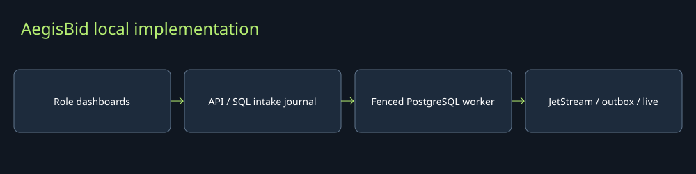
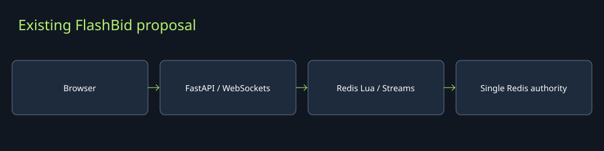
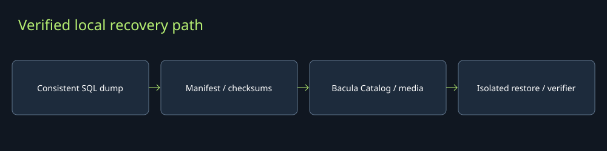
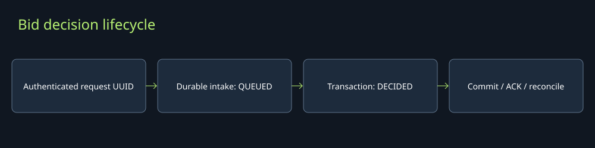

# AEGISBID OMEGA
## Complete architecture and engineering explanation

**Project title:** *AegisBid Omega: A Fault-Tolerant, Verifiable and Disaster-Recoverable Flash-Auction Platform*

**The assignment:** A regional e-commerce operator needs to serve as many as 50,000 concurrent bidders, with intense activity in the final 10 seconds of auctions for limited-stock items. The former REST system exhibited race conditions, stale reads and crashes under traffic spikes. This report describes a proposed architecture with an operator/admin dashboard and a genuine Bacula backup-and-restore design.

**Status:** The full target architecture is a **proposal**. The existing FlashBid report describes an earlier, smaller prototype; features in this new report are not automatically implemented. Scale claims, disaster recovery objectives and chaos outcomes require measurements.

# 1. Architecture in one minute

AegisBid uses four parallel concerns:

- **Correctness plane:** A durably recorded bid command becomes a final decision in one authoritative database transaction, evaluated in a consistent order per auction.
- **Experience plane:** WebSocket gateways push versioned auction updates to many users without making the gateway the bid authority.
- **Trust and observability plane:** An append-only logical decision history, audit receipts, independent replay and live operational analytics make the system explainable.
- **Disaster recovery plane:** Replicas help with short failures; Bacula protects prepared backups and supports isolated restoration when replicas are insufficient or data is damaged.

# 2. Existing FlashBid architecture (V1)

The earlier FlashBid design documented a browser, FastAPI application, WebSockets, Redis Lua scripts, Redis sorted sets, Pub/Sub updates, Redis Streams and an auction closer. It intended to handle bid rules atomically and avoid naive read-modify-write race conditions. The provided report describes **one FastAPI service and one Redis AOF container** as its prototype deployment; its 50,000-client figure is a scalability requirement, not a measured test result.

### What the original design did well

- Server-side atomic bid checks using Redis Lua, avoiding conflicting updates through ordinary application races.
- Fast WebSocket delivery rather than polling every 100 ms for changes.
- Stable request identifiers and versioned snapshots.
- Deterministic selection of at most `stock` winners from unique bidder offers.
- Initial audit events and useful integration/load-test planning.

### Why it is not yet an enterprise recovery system

A single Redis authority and single API service are still operational concentrations of risk. AOF alone is not an independent offsite backup, a restart is not proof of correct failover, and fast in-memory bidding does not itself demonstrate recovery from deletion or ransomware. The prior report also does not prove that 50,000 active sockets or simultaneous bids were achieved.

| Design concern | Existing V1 | Proposed Omega |
|---|---|---|
| Primary bid state | Redis atomic Lua | Transactional PostgreSQL decision ledger |
| Command intake | FastAPI -> Redis | Durable JetStream intake with per-auction ordering |
| Client feedback | WebSocket snapshots | Explicit QUEUED / DECIDED / DELIVERED lifecycle |
| Worker failure | Restart prototype | Idempotent replay, active/standby and fencing |
| Horizontal scaling | Proposed gateway replicas | Partitioned auctions, bounded fanout and isolation |
| Evidence | Redis audit stream | Ledger, independently checked event chain, signed result manifest |
| Data loss recovery | AOF / restart | Consistent SQL backups + WAL + Bacula offsite restore |
| Admin capability | Prototype monitoring | War Room: operations, performance, backup freshness and incidents |

# 3. Overall design: seven logical layers

## Layer 1 — Role-specific application layer

**Bidder:** discovers auctions, submits bids, sees current ranking, pending/accepted/rejected status, countdown, notifications, reconnect recovery and winner receipts.

**Seller:** creates and schedules auctions, defines stock and increments, sees allowed analytics and exports an auction result.

**Administrator:** monitors all infrastructure, error rate, connections, bids/sec, latency, data freshness, Bacula jobs and restore drills; may trigger controlled test scenarios in a disposable environment.

**Independent auditor:** sees privacy-safe event evidence, validates signatures and reconstructs winners using a separately implemented verification program.

Roles have separate server-side authorization even if they share a single web codebase. The professor's explicit minimum is to show both **user and admin dashboards** and at least basic admin analytics.

## Layer 2 — Edge, identity and real-time fanout

A load balancer sends long-lived WebSocket connections to gateways. Admission services authenticate bidder identity, apply bid-rate limits and create unique command IDs. Gateways have no power to declare a bid accepted merely because a WebSocket message was delivered. All clients can reconnect and query their previous request IDs.

**Adaptive fanout:** During a final-10-second surge, send high-priority price/version changes while coalescing redundant intermediate snapshots. Disconnect or degrade slow consumers before their unbounded queues exhaust gateway RAM. The authoritative bid decision always remains independent of fanout delay.

## Layer 3 — Durable, ordered command plane

A subject `auction.<id>.commands` receives commands. NATS JetStream is a proposed durable log; use **three replicas** for a target deployment. Assign each auction to a deterministic processing partition, preserving arrival order for that auction. JetStream provides stream storage and at-least-once consumer delivery; duplicates and replays remain possible.

The command log is an **input journal**, not the ledger of accepted winners. Intake acknowledgment proves only that the command is queued under the stream's configured durability. Final status comes from PostgreSQL.

## Layer 4 — Deterministic auction processing core

The active worker for an auction reads ordered commands, checks the current auction state, applies business rules and commits a definitive decision. Other auctions may run on other workers. Each auction is a logical serializable state machine, even when gateways and request producers are parallel.

**Fencing:** A lease/epoch value is stored in the authoritative database. Every transaction checks the latest epoch under locking. A former leader cannot commit if its epoch is stale. An actual HA rollout also needs carefully tested PostgreSQL primary fencing; a naive worker lease cannot fix a split-brain database cluster.

**Invariants:** No accepted request can be applied twice, no final allocation exceeds stock, a closed auction cannot accept ineligible late bids, and every displayed winner must be derivable from durable decisions and the documented allocation rules.

## Layer 5 — Authoritative database and read projections

PostgreSQL holds auction metadata, accepted/rejected decision records, current offers, final allocations, durable outbox events, leases and ledger hashes. For business correctness, the decision and matching outbox row commit in **one transaction**. An outbox relay later publishes versioned updates. This allows the WebSocket notification to fail independently without undoing a valid committed bid.

Redis becomes a **rebuildable read cache**. If Redis disappears, bidder views can temporarily degrade or refresh from SQL; the auction cannot lose authoritative winners merely because a cache vanished.

## Layer 6 — Evidence, operations and chaos testing

Prometheus and Grafana collect measurable service metrics. Traces correlate client request -> durable enqueue -> worker decision -> DB transaction -> fanout. A read-only replay service consumes ledger exports and calculates whether the winner list matches the specified rules.

A test-only chaos controller can terminate a worker, disconnect a gateway, pause consumers and wipe the disposable Redis cache. Tests must show real process failures; a dashboard animation is not proof of recovery.

## Layer 7 — Bacula backup domain and disaster recovery

Bacula's Director schedules and controls jobs; File Daemons read prepared backups; the Storage Daemon stores Bacula volumes; the Catalog tracks content and storage locations. A truly independent copy lives offsite or in a separately protected storage domain, with separately recoverable backup Catalog, configurations and credentials.

**Bacula is not in the live bid request path.** It is for recovering from data loss/corruption/disaster, not for deciding winners at 10 ms latency.

# 4. Exact bid and event flows

## Flow A: a successful bid

1. Bidder signs in and opens auction `A-01`; WebSocket subscribes to versioned updates.
2. Browser submits `request_id` and amount; server checks identity and limits.
3. Admission layer creates a server-authoritative admission record and durably publishes a command.
4. API responds `QUEUED`, not `ACCEPTED`. The user now knows the command was stored but not yet evaluated.
5. The worker verifies the current leader epoch and runs the decision transaction.
6. Inside that transaction, it validates price, auction status, documented cutoff policy and idempotency; inserts the decision, changes current offers and creates an outbox record.
7. Post-commit, the worker acknowledges message processing. The outbox relay pushes the resulting version to gateways.
8. The bidder sees final status and receipt. A reconnecting bidder can always retrieve the committed result by request ID.

## Flow B: two bids compete for the same next price

Suppose the current required bid is $101 and two different users simultaneously request $101. The per-auction engine serializes final decisions. Under a strict increment rule, the first valid decision can move the high offer to $101, and the second $101 is rejected for being too low. A browser notification delay does not let the second client override the authoritative database state.

## Flow C: crash after database commit, before notification

The worker commits an `ACCEPTED` decision and crashes before acknowledging NATS or notifying the browser. NATS redelivers the command to a replacement. The replacement looks up the original request ID and finds the existing decision; it does not insert another winner. The outbox relay can deliver the existing decision later. The bidder sees a temporarily pending result, then resolves it using the request ID.

## Flow D: final 10 seconds and close

The system must document one consistent admission cutoff rule. In the prototype, a server-stamped durable admission time is compared with the auction deadline, with bounded clock synchronization assumptions. For a stronger design, use a per-auction sequencer and a durable closing boundary event, and define precisely what happens to in-flight commands on worker failure. **A client-side countdown is informative, not legally authoritative.**

# 5. Consistency guarantees: what can honestly be claimed?

| Question | Correct answer |
|---|---|
| Can a client lose its WebSocket while the bid still succeeds? | Yes; query the same request ID before retrying |
| Does JetStream's acknowledgment mean the bid won? | No; only that intake reached the configured durability point |
| Can NATS redeliver a message? | Yes; use DB idempotency + unique constraints |
| Can accepted bids be duplicated by a worker restart? | Application must prevent this with transactional request ID checks |
| Does a WebSocket view show the newest value at every instant? | Not necessarily; views are eventually refreshed and versioned |
| Is Redis still useful? | Yes, as an inexpensive cache / fanout aid, not the sole business authority |
| Does 3-node replication protect from every failure? | No; quorum loss, split-brain mistakes, common-mode failure and deletion remain threats |
| Does Bacula provide zero-data-loss failover? | No; independent backup and point-in-time restore have a finite recovery point |

**Exactly-once business effect vs exactly-once transport:** Network delivery can duplicate. The defensible goal is to ensure that a replayed request cannot commit a second business outcome.

# 6. The unique subsystems and their architecture value

| Subsystem | Novel user-visible behavior | Engineering mechanism | Proof to show |
|---|---|---|---|
| **Chaos Switchboard** | Admin intentionally kills workers / gateways | Test-only fault controller + health probes | Failure log, recovery time, zero duplicate effects |
| **Auction Black Box** | Replay second by second | Deterministic event export + replay engine | Rebuilt winners equal authoritative winners |
| **BidDNA Passport** | Bidder downloads receipt with verifiable hash | Canonical events + signed manifest | Changed event is detected |
| **AegisVault** | Admin sees Bacula backup / restore | Director jobs + independent backup volumes | Actual job ID and restored database |
| **Proof-of-Recovery** | Recovery produces pass/fail certificate | Checksums + SQL invariant verifier | Restore evidence and measured RPO/RTO |
| **Parallel-Universe Lab** | Same auction workload runs in old and new systems | Seeded load replay against isolated baselines | Correctness/throughput comparison |
| **Auction Firebreaks** | One viral auction cannot consume unbounded resources | Partition budgets + queue caps + fanout coalescing | Unrelated auction remains usable under test |
| **Causal Incident Map** | Admin sees failure propagation | Correlated traces and event timestamps | Incident root cause and downstream effect |
| **Self-Healing Leadership** | Standby takes over a crashed worker | Epoch fencing + DB reconciliation | Recovered service and no stale leader commits |
| **Uncertain-Bid Reconciliation** | UI explains outcome after lost acknowledgment | Request-ID status lookup | Correct prior result after reconnect |
| **Surge Pre-Warming** | Capacity expands before known end time | Scheduled gateway start and controlled admission | Connection/latency curve before and after |
| **Independent Audit Portal** | External observer verifies published result | Signed evidence + isolated verifier | PASS/FAIL independent of dashboard |

The originality comes from **combining reliability, data protection and independently verifiable results** into one demonstrable auction design. It is not accurate to claim that these general engineering techniques were never previously used anywhere.

# 7. Scaling to a 50,000-user target

## Network fanout and cost

Example calculation: 50,000 connections receiving two 300-byte updates per second consume around **30 MB/s of application payload** before TLS, WebSocket, TCP/IP overhead and retransmissions. This is an illustration, not benchmark output. Broadcasting snapshots five times each second with a 250-byte payload would instead send **62.5 MB/s** of raw application payload.

Therefore, use several gateways, compact delta messages, bounded queues, subscription filtering, connection rebalancing and measured network capacity. Avoid a full JSON auction snapshot on every single bid.

## Correctness throughput

Workers for *different auctions* can process concurrently, but one hot auction still requires one logically ordered acceptance policy. SQL row locking and synchronized durable commits may limit its maximum decisions/sec. Profile `db_transaction_seconds`, queue age and hot-auction contention before projecting any scale.

## Saturation policy

A healthy system should reject or queue requests explicitly when overloaded. It must not claim all 50,000 bidders' offers were accepted instantly. A **controlled 429**, a **QUEUED** state, or a pause after quorum loss is better than silent duplicate winners or invented acknowledgments.

# 8. High availability vs disaster recovery

**High availability (HA)** protects against routine process or host failures using replication, health checks, reconnections and safe leader change. **Disaster recovery (DR)** restores data and services after severe loss or corruption using independent backups, clean environments and documented recovery steps. They solve different problems.

| Failure | Normal response | Remaining risk / action |
|---|---|---|
| Single gateway dies | Reconnect to another gateway, refresh state | Brief user-visible interruption |
| Active worker dies | Fence prior worker, replay pending intake | Validate new worker's epoch and DB position |
| Redis cache disappears | Reconstruct projections | Temporary read/fanout slowdown |
| One NATS replica dies | Remaining quorum can make progress | Two failures may remove quorum; no false durable ACK |
| PostgreSQL primary dies | Safe, fenced promotion if HA standby exists | Standby lag depends on replication mode; validate reconciliation |
| Data is accidentally deleted | Isolate writes and restore known-good point | Restoration may roll back acknowledged post-checkpoint data |
| Ransomware damages site | Recover in clean environment from protected copy | Confirm backup integrity and independence first |
| All primary-site machines fail | Rebuild or activate separate DR site | Recovery depends on backup transfer, keys, Catalog and runbook |
| Backup Director/Catalog lost | Recover Bacula control plane | Protect Catalog, configuration, encryption keys and volume index |

**No architecture can truthfully promise both unlimited availability and perfect consistency through every network partition.** Under insufficient quorum, preserve safety and report a degraded state.

# 9. Bacula recovery plane in detail

## 9.1 Why the professor's Bacula question matters

A simple replica will faithfully reproduce some mistakes, including accidental deletion. A server restart will not recover a corrupted or deleted disk. A backup solution needs a copy that the same application credentials, same RAID failure, or same infrastructure incident cannot silently destroy.

Bacula orchestrates backing up and restoring **prepared, consistent files**. For PostgreSQL, prepare `pg_basebackup` output, WAL archives and metadata. For JetStream, use its supported snapshot/export tooling. Keep an independent authoritative SQL ledger for accepted decisions and reconcile command-log offsets when restoring.

## 9.2 Backup layout

| Backup asset | Production protection | Restore dependency |
|---|---|---|
| PostgreSQL base backup | Periodic full consistent database backup | Matching server version, complete base files |
| PostgreSQL WAL | Continuous archiving and timely offsite shipping | Unbroken WAL chain through target recovery time |
| NATS stream snapshots | Scheduled supported stream export | Stream identity, sequence metadata, consistent checkpoint |
| Auction manifests | After closing each auction | Verification keys and canonical serialization rules |
| Configuration and images | Versioned code plus protected deployment config | New hosts, registry access, environment secrets |
| Bacula Catalog and configs | Separate protected backup | Director/Storage settings and media index |
| Signing/encryption keys | Restricted, separately recoverable key backup | Safe receipt verification and decryption |

Bacula does **not** guarantee that independently captured PostgreSQL and NATS snapshots represent the exact same logical instant. Recovery must reconcile using committed decision IDs, event sequence numbers and queued/processed command offsets.

## 9.3 Proposed policy and measurable goals

| Category | Proposed schedule | Important caveat |
|---|---|---|
| PostgreSQL base backup | Daily | Must validate backup integrity |
| WAL archive | Continuously + frequent offsite transfer | RPO depends on proven fresh coverage |
| NATS snapshots | Every 30 minutes and important checkpoints | Not a replacement for SQL accepted-decision authority |
| App/evidence backup | Daily plus after major close | Preserve signatures and validation manifests |
| Bacula Catalog/config | Every backup cycle / daily | Must survive loss of Director host |
| Restore exercise | Weekly and after schema changes | A job success alone does not prove a restore |

Target full-site **RPO <= 15 minutes** and **RTO <= 60 minutes**, pending proof. Measure these values; do not confuse them with expected sub-minute worker restart.

## 9.4 Disaster restoration algorithm

1. Declare incident and isolate affected credentials/network; freeze unsafe writes.
2. Choose a clean Bacula backup and identify its export manifest, hashes, PostgreSQL base and WAL coverage.
3. Restore into a new isolated host or database, never directly into a still-running production authority.
4. Verify backup hashes, restore PostgreSQL/PITR, import supported stream state if necessary, and reconstruct SQL/stream offsets.
5. Run the verifier: no duplicated decisions, no over-allocation, valid event-chain links, valid winner recomputation and matching schema version.
6. Calculate true data-loss window and restore duration. Flag unresolved acknowledged bids as exceptions.
7. Re-establish one fenced authority, rotate compromised credentials if necessary, then intentionally reopen service.
8. Publish a recovery report with PASS/FAIL/INCOMPLETE, actual limits and next actions.

# 10. Evidence, experiments and report figures

Build a test report with **three kinds of numbers**: measured workload results, measured recovery results and conceptual capacity calculations. Do not mix them.

| Experiment | Independent variable | Measured evidence | Main lesson |
|---|---|---|---|
| Race baseline vs new | Number of competing requests | Conflicting decisions, p95, winner mismatch | Correctness under contention |
| Last-10-second surge | Connection count / bids per second | Errors, queue age, decision latency | Capacity and controlled degradation |
| Worker crash | Crash time relative to decision | Duplicate count, recovery duration | Idempotency and failover |
| Replica failure | Number of failed replicas | Quorum status, ack behavior | Durability assumptions |
| Redis cache loss | Cache reset | Projection rebuild time | Separation of cache and authority |
| Bacula restore | Backup age and dataset size | Actual restored data, checksums, RPO/RTO | Independent recoverability |
| Evidence tampering | Modify historical event copy | Verifier alerts | Auditability |

Use screenshots of real dashboards, logs, Bacula `bconsole`, restored SQL tables, test runner output and resource usage. Label system diagrams as **proposed** until verified by deployment.

# 11. Core technology and design trade-offs

| Choice | Why chosen | Cost / limitation |
|---|---|---|
| Next.js + Tailwind | Polished role-specific interfaces | UI does not establish correctness |
| FastAPI (MVP) | Reuse existing implementation and test harness | Python gateway may need scaling for sockets |
| Go gateways/workers (target) | Concurrency control and efficient networking | Adds engineering complexity |
| NATS JetStream | Durable intake, replay and configurable replication | At-least-once delivery; operational quorum dependencies |
| PostgreSQL | Transactional final decisions, unique keys and recoverable WAL | Hot auction locks may limit throughput |
| Redis | Cheap read projections and Pub/Sub utilities | Cache must not become final authority |
| Prometheus + Grafana | Evidence-based analytics | Cardinality, monitoring overhead |
| Bacula | Backup job control, media and restore workflows | Not instant failover; Catalog/volume protection required |
| Signed event manifest | Detects tampering relative to trusted anchor | Depends on key custody and integrity of initial event source |
| Docker Compose | Reproducible coursework deployment | Not multi-zone availability on one laptop |

# 12. Why the design is a strong CEP answer

The CEP is not asking for a typical shopping website; it is asking how to engineer reliable bidding under a dangerous, bursty workload. This design gives clear engineering answers:

1. **Race conditions:** one definitive transactional decision order and unique request-ID effects.
2. **Stale reads:** versioned WebSocket state, refresh on gaps and authoritative request-status lookup.
3. **Traffic spikes:** scalable gateways, per-auction partitions, bounded queues and explicit overload behavior.
4. **Server crashes:** replayable intake, worker replacement and fenced leadership.
5. **Disasters/data loss:** Bacula-managed protected backups, PostgreSQL PITR and isolated restoration.
6. **Can we trust the winner?:** replay against independent invariants and signed evidence.
7. **Can the professor inspect it?:** user dashboard, admin War Room, measured metrics, logs and a <=3-minute video with demonstrated tests.

**Recommendation:** In the short submission window, show a true working vertical slice: one real auction, connected bidders, a usable admin dashboard, real bid-race test, worker restart, Bacula backup and isolated restore, and independent result verification. Describe the multi-region, 50,000-client system as a designed extension unless genuinely tested.

# References (official documentation)

- Bacula documentation index: https://www.bacula.org/documentation/documentation/
- Bacula Community manual: https://www.bacula.org/15.0.x-manuals/en/main/index.html
- Bacula Director configuration: https://www.bacula.org/15.0.x-manuals/en/main/Configuring_Director.html
- Bacula restore command: https://www.bacula.org/13.0.x-manuals/en/main/Restore_Command.html
- PostgreSQL base backup: https://www.postgresql.org/docs/18/app-pgbasebackup.html
- PostgreSQL continuous archiving/PITR: https://www.postgresql.org/docs/18/continuous-archiving.html
- NATS JetStream fundamentals: https://docs.nats.io/concepts/jetstream
- NATS clusters and replication: https://docs.nats.io/learn/clustering/

